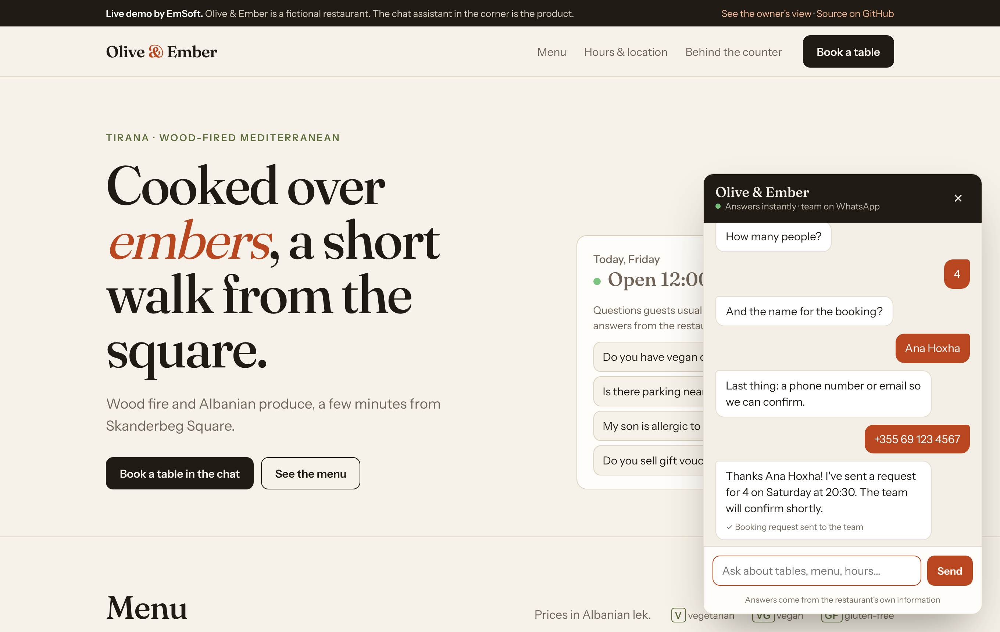
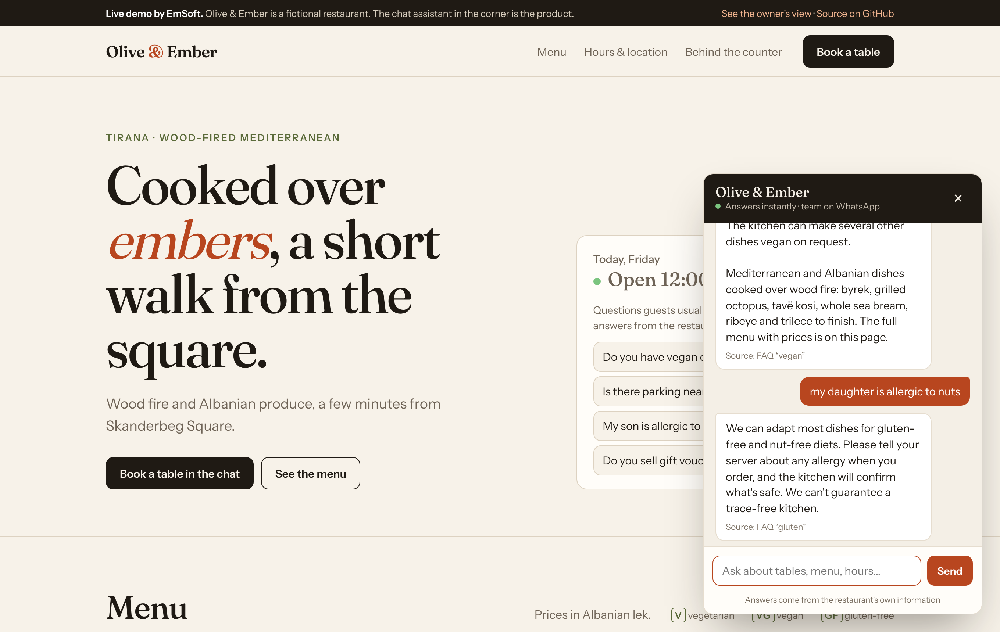
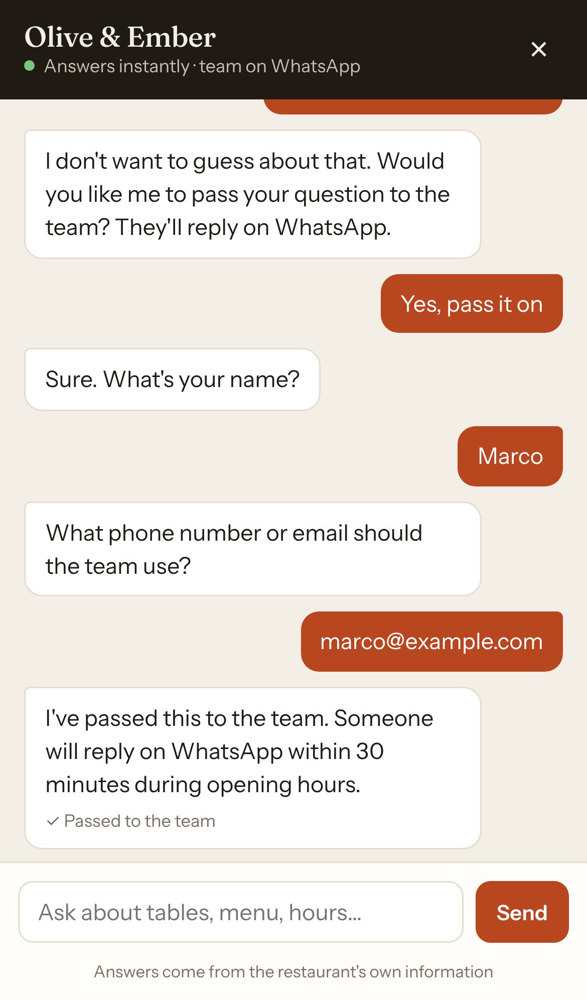
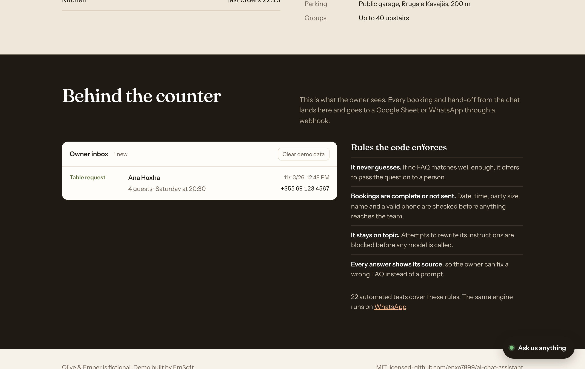

# AI Chat Assistant for small businesses (website + WhatsApp)

An AI customer assistant that answers questions from a business's **own** information, takes bookings, captures leads and hands the conversation to a person when it isn't sure. The same engine runs the website widget and a WhatsApp Business webhook.

**▶ Live demo: https://enxo7899.github.io/ai-chat-assistant/** (a fictional restaurant, Olive & Ember. Tap a question in the "Today" card or book a table, then scroll to *Behind the counter* to see what the owner receives.)



## What it does

| | |
|---|---|
| **Answers from your info only** | Hours, prices, menu, allergies, parking, events. Every reply comes from `data/knowledge.json` and shows which entry it used. |
| **Doesn't make things up** | Below a confidence threshold it says it isn't sure and offers to pass the question to the team. |
| **Books and captures leads** | Walks the customer through day, time, party size, name and contact, validating each step. |
| **Hands off to a person** | "Talk to a person", complaints and unanswered questions become a hand-off lead with the question and transcript attached. |
| **Sends leads where you work** | Google Sheets, n8n, Make, Zapier or a CRM through one webhook URL. |
| **Guardrails** | Blocks prompt-injection attempts ("ignore previous instructions…") and keeps to the business's topics. |
| **WhatsApp** | `server/whatsapp-webhook.js` connects the same assistant to the WhatsApp Business Cloud API. |
| **Optional LLM replies** | With an Anthropic API key, Claude rewrites the matched FAQ facts into a natural reply in the customer's language. It may only use those facts and answers `HANDOFF` otherwise. |

| FAQ answers with sources | Hand-off on mobile | What the owner receives |
|---|---|---|
|  |  |  |

## How it works

```
customer message
      │
      ▼
 guardrails ── blocked ──► polite refusal
      │
 active flow? ── yes ──► booking / hand-off steps (validated) ──► lead ──► webhook (Sheets / CRM / n8n)
      │
 intent: book / person ──► start flow
      │
 rank FAQ entries (keyword + wording match)
      │
 score ≥ threshold ── no ──► "I don't want to guess" + offer hand-off
      │ yes
      ▼
 FAQ answer  ──(optional)──► Claude rephrases using only the matched facts
```

Bookings, hand-offs and guardrails are deterministic code, not model output, so they behave the same every time. The model is only used to word answers, which keeps costs low and stops it inventing prices or opening hours.

## Use it for your own business

1. Edit `data/knowledge.json`: business details, FAQs with keywords, booking words and the hand-off message.
2. Embed the widget on any site:
   ```html
   <link rel="stylesheet" href="widget.css" />
   <script type="module">
     import { mountWidget } from "./widget.js";
     mountWidget({ kbUrl: "knowledge.json", webhook: "https://script.google.com/macros/s/…/exec" });
   </script>
   ```
3. For WhatsApp, create an app in Meta for Developers, add the WhatsApp product, then:
   ```bash
   npm install
   WHATSAPP_TOKEN=… WHATSAPP_PHONE_ID=… WHATSAPP_VERIFY_TOKEN=… npm run whatsapp
   ```
   Point the Meta webhook at `https://your-server/webhook`. Add `ANTHROPIC_API_KEY` for natural-language replies and `LEAD_WEBHOOK` to forward leads.

## Run locally

```bash
npm install
npm test          # 22 tests: FAQ matching, booking flow, hand-off, guardrails, sessions
npm run dev       # http://localhost:5173
npm run screenshots   # with dev running: regenerates docs/*.png and fails loudly on console errors
```

Add `?open&script=booking` (or `faq`, `handoff`) to the demo URL to replay a scripted conversation.

## Tests

`tests/engine.test.js` checks the behaviour a business owner cares about: 16 real-world phrasings (including Albanian) map to the right answer, unknown questions are never guessed, a full booking produces a correct lead, bad phone numbers are re-asked, bookings can be cancelled, injection attempts are blocked and conversations don't leak between customers.

## Stack

Vanilla JavaScript (no build step), Node.js, WhatsApp Business Cloud API, Anthropic Claude API (optional), GitHub Pages and Actions.

---

Built by **[EmSoft](https://github.com/enxo7899)**: AI chatbots, agents and automations for small businesses. Need one for your business? Get in touch through my Fiverr or Upwork profile.
